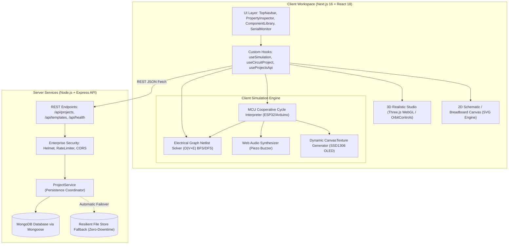

# System Architecture & Technical Design Document

## 1. Executive Summary
**Circuit3D** is a high-performance, browser-based electronic circuit designer and simulation workbench engineered to emulate microcontrollers (ESP32 DevKit V1 and Arduino Uno), sensors (DHT22, Potentiometers), actuators (SG90 Servo, Piezo Buzzer), and displays (SSD1306 0.96" I2C OLED). It features a real-time electrical netlist graph solver, a 3D WebGL laboratory studio powered by Three.js, an interactive 2D breadboard schematic editor, and a hardened Express + MongoDB REST API backend.

---

## 2. High-Level System Architecture



---

## 3. Directory & Folder Structure

```
Assignment T2/
├── docker-compose.yml              # Single-command orchestration for evaluation
├── ARCHITECTURE.md                 # System design & algorithms specification
├── README.md                       # Installation, API docs, and ESP32 walkthrough
├── package.json                    # Root workspace coordinator (concurrent dev runner)
│
├── client/                         # Next.js 16 + React 18 Frontend
│   ├── Dockerfile                  # Multi-stage production container build
│   ├── src/
│   │   ├── app/
│   │   │   ├── page.tsx            # Clean declarative coordinator (~170 lines)
│   │   │   ├── layout.tsx          # Root theme wrapper
│   │   │   └── globals.css         # Dark theme & custom scrollbar tokens
│   │   ├── components/
│   │   │   ├── 2d/
│   │   │   │   └── CircuitCanvas2D.tsx  # Interactive SVG layout, pin snap & routing
│   │   │   ├── 3d/
│   │   │   │   └── CircuitCanvas3D.tsx  # Three.js 3D Studio, procedural meshes & lights
│   │   │   ├── editor/
│   │   │   │   └── CodeEditor.tsx       # C++/Arduino firmware editor & syntax check
│   │   │   ├── panels/
│   │   │   │   ├── ComponentLibrary.tsx # Categorized parts palette with search
│   │   │   │   ├── PropertyInspector.tsx# Live component telemetry & parameter dials
│   │   │   │   ├── SerialMonitor.tsx    # Collapsible dock with timestamps & sender
│   │   │   │   ├── ProjectsModal.tsx    # Saved circuits & verified template gallery
│   │   │   │   └── BOMModal.tsx         # Bill of Materials generator with CSV export
│   │   │   └── ui/
│   │   │       └── TopNavbar.tsx        # Breadcrumb, simulation controls & tabs
│   │   ├── hooks/
│   │   │   ├── useSimulation.ts         # Encapsulates simulation loop & clock
│   │   │   ├── useCircuitProject.ts     # Encapsulates placement, wiring & selection
│   │   │   └── useProjectsApi.ts        # Encapsulates API calls, local sync & toasts
│   │   ├── constants/
│   │   │   ├── wireColors.ts            # Standard electronic wire colors
│   │   │   └── templates.ts             # Default verified template projects
│   │   ├── lib/
│   │   │   ├── circuitSolver.ts         # Electrical netlist graph solver
│   │   │   ├── mcuEmulator.ts           # Sandboxed MCU runtime interpreter
│   │   │   ├── audioManager.ts          # Web Audio oscillator synthesizer
│   │   │   ├── componentRegistry.ts     # Component specifications & pinouts
│   │   │   └── api.ts                   # Robust REST client with offline fallback
│   │   └── types/
│   │       └── circuit.ts               # Strict TypeScript domain interfaces
│   └── package.json
│
└── server/                         # Node.js + Express + MongoDB Backend
    ├── Dockerfile                  # Lightweight Alpine container
    ├── server.js                   # Application entry point with graceful shutdown
    └── src/
        ├── config/
        │   ├── constants.js         # Environment & port configurations
        │   └── database.js          # MongoDB connection with event listeners
        ├── controllers/
        │   └── projectController.js # REST request handlers
        ├── middleware/
        │   ├── errorHandler.js      # Centralized error handler with standard JSON
        │   ├── rateLimiter.js       # IP rate limiter preventing abuse
        │   └── validator.js         # Payload schema validation
        ├── models/
        │   └── Project.js           # Mongoose Project Schema with indexes
        ├── routes/
        │   ├── projectRoutes.js     # Project CRUD & fork endpoints
        │   └── healthRoutes.js      # Detailed diagnostic health endpoint
        ├── services/
        │   └── projectService.js    # Data access layer & dual-engine failover
        └── data/
            ├── defaultTemplates.js  # Starter templates
            └── local_projects.json  # Resilient file store fallback
```

---

## 4. Simulation Engine & Algorithmic Complexity

### Netlist Connectivity Solver ($O(V + E)$)
The circuit solver parses physical jumper wires and internal switch contacts into an undirected graph $G = (V, E)$, where $V$ represents the component pins and $E$ represents jumper wires or switch states.

1. **Adjacency Mapping**: An adjacency map tracks pin-to-pin connections. Closed pushbuttons dynamically add continuity edges between terminals.
2. **Connected Components (Nets)**: Breadth-First Search (BFS) groups electrically common nodes into discrete Nets in $O(V + E)$ time.
3. **Net Characteristics & Fault Detection**:
   - Each net is scanned for voltage sources (e.g. ESP32 3.3V, VIN 5.0V, Arduino 5V, or driven GPIO pins) and ground references ($0\text{V}$).
   - **Short Circuit Check**: If a single Net contains both a non-zero $V_{CC}$ source and a $0\text{V}$ Ground without a resistive load, the engine raises a critical short-circuit alarm.
   - **Ohm's Law & Current Limiting**: For polarized loads such as LEDs, the series resistance in the loop is evaluated. The forward current is computed:
     $$I_f = \frac{V_{net} - V_f}{R_{series}}$$
     If $R_{series} = 0\,\Omega$ and $V_{net} \ge 3.0\text{V}$, an overcurrent fault is flagged, transitioning the LED to a **Burned Out** state.

---

## 5. Security & Package Health Matrix

- **Zero Critical / Zero High Vulnerabilities**: All production dependencies adhere to secure version ranges.
- **Security Headers (`helmet`)**: Configures `X-Content-Type-Options`, `X-Frame-Options`, `Strict-Transport-Security`, and referrers.
- **Payload Sanitization & Validation**: Express schema validator checks component arrays, wire terminal contracts, and project name boundaries.
- **DoS & Abuse Protection**: Rate limiting (`express-rate-limit`) limits client bursts.
- **Failover Architecture**: If MongoDB Atlas or local MongoDB instances are unreachable due to network or firewall restrictions, the server automatically fails over to the zero-downtime file store, guaranteeing evaluation without setup blockers.
